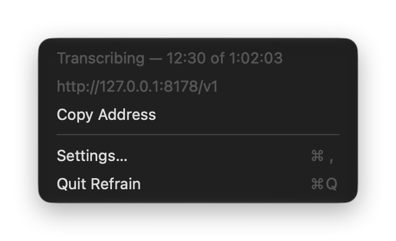
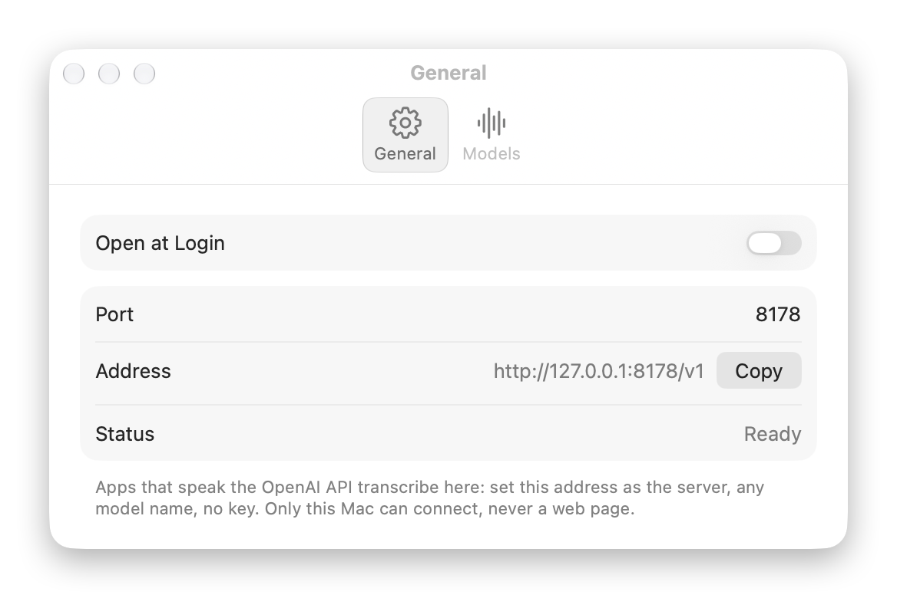
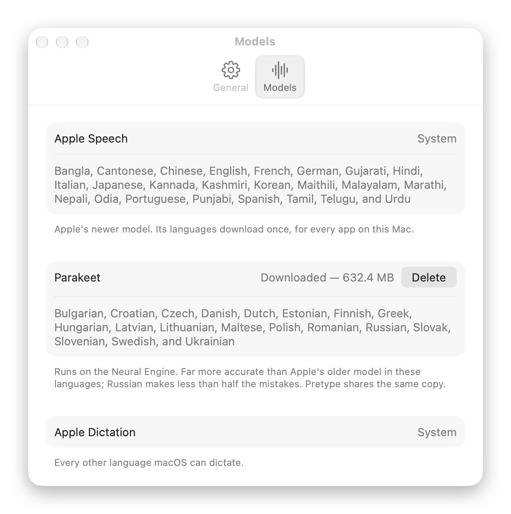

<p align="center">
  
</p>

<h1 align="center">Refrain</h1>

<p align="center"><b>Every word stays on your Mac.</b><br>
An open-source speech-to-text engine for macOS. It lives in the menu bar and turns audio into text on the Neural Engine. Any app on the Mac reaches it through the API it already knows, OpenAI's <code>POST /v1/audio/transcriptions</code>.</p>

<p align="center">macOS 26 or later · English and Russian · free, MIT · 0.1</p>

There is no signed release yet: build it from source (below). Signed releases and Homebrew come with 1.0.

<p align="center">
  
</p>

## Use it

Point any OpenAI-compatible client at `http://127.0.0.1:8178/v1`, with any model name and no key.

```sh
curl http://127.0.0.1:8178/v1/audio/transcriptions -F file=@call.m4a -F language=en
# {"text":"Hi! Yesterday I called Nikolai…"}
```

```python
from openai import OpenAI
client = OpenAI(base_url="http://127.0.0.1:8178/v1", api_key="none")
with open("call.m4a", "rb") as f:
    print(client.audio.transcriptions.create(model="auto", file=f, response_format="verbose_json").segments)
```

- **`file`**: anything AVFoundation reads: m4a, mp3, wav, caf, mp4.
- **`language`**: ISO 639-1 (`ru`, `en`). It picks the engine. Without it, Parakeet detects the language if it's downloaded, otherwise Apple's model for the system language is used. `languages[]`, as `gpt-transcribe` takes it, works too: the first one counts.
- **`prompt`** and **`keywords[]`**: the keywords, and the names and terms in the prompt (capitalized mid-sentence, or like `iPhone`, `MLX`), are passed as spelling hints to Apple's older model, the only engine that takes them. Apple's newer model spells names the same with hints or without, and Parakeet takes none.
- **`response_format`**: `json`, `text`, `srt`, `vtt` or `verbose_json`, with segment timestamps and, with `timestamp_granularities[]=word`, word timestamps. `diarized_json`, as OpenAI's `gpt-4o-transcribe-diarize` returns it, tells the voices apart: each phrase has a `speaker`, `A`, `B`… It needs the speaker model (22 MB, Settings › Models); without it the request gets a 400.
- **`model`** is accepted and ignored. `GET /v1/models` lists one model, `auto`.

Requests run one at a time, in order. The port can be changed in Settings; Refrain never moves to another one on its own, since clients have it written down.

### Connect your apps

- **[Reprise](https://github.com/nikiomori/reprise):** Settings › Transcription › Service › *Refrain (this Mac)*. When Refrain is running, Reprise offers it there itself. With each side saved on its own and the speaker model downloaded, the transcript says who spoke: you, or which of the others.
- **[Pretype](https://github.com/nikiomori/pretype):** Settings › API › *Use an API model for dictation* › Provider › *Refrain (this Mac)*. Pretype then dictates through Refrain's models instead of loading its own, with the live preview (it re-sends the take about once a second), and sends the names in the field as spelling hints.
- **Scripts on the OpenAI SDK** (Python, Node) read the server from the environment, so they run unchanged:
  ```sh
  export OPENAI_BASE_URL=http://127.0.0.1:8178/v1 OPENAI_API_KEY=refrain
  ```
  Only transcription is served: a chat request from the same script gets a 404.
- **Apps in Docker** (Open WebUI, LibreChat): base URL `http://host.docker.internal:8178/v1`.
- **Shortcuts, Spotlight and Siri:** the *Transcribe Audio File* action takes a file and gives back its text. In a shortcut that receives files from Quick Actions, it's in Finder's right-click menu.
- **Any other app** that lets you set an OpenAI-compatible or Whisper server: base URL `http://127.0.0.1:8178/v1`, any model name, any key or none. Some, like VoiceInk and Obsidian Whisper, want the full address: `http://127.0.0.1:8178/v1/audio/transcriptions`.

<p align="center">
<picture>
  <source media="(prefers-color-scheme: dark)" srcset="docs/media/settings-general-dark.png">
  
</picture>
</p>

## Engines

Picked by language, by measured error rate rather than by brand (FLEURS, Pretype's `Eval/asr`):

| Languages | Engine | Why |
|---|---|---|
| English, German, French, Spanish, Italian, Japanese, Korean, Portuguese, Chinese… | Apple SpeechTranscriber | System models, nothing to download for the app. On English it ties Parakeet (WER 7.8 vs 6.6) |
| Russian, Ukrainian, Polish, Czech and the rest of Parakeet's 25 European languages | Parakeet Ultra on the Neural Engine, 630 MB, downloaded only when you press *Download* | Russian as typed: WER 30.1 → 12.3, punctuation F1 0.02 → 0.85 |
| Every other language macOS dictates | Apple DictationTranscriber | It's there, though without punctuation: Apple's older model writes none for files, whatever it's asked |

<p align="center">
<picture>
  <source media="(prefers-color-scheme: dark)" srcset="docs/media/settings-models-dark.png">
  
</picture>
</p>

Parakeet lives in FluidAudio's shared cache (`~/Library/Application Support/FluidAudio/Models`), so [Pretype](https://github.com/nikiomori/pretype) and Refrain download it once between them.

## Resources

Release build, MacBook Pro M4 Max:

| | CPU | Memory |
|---|---|---|
| Waiting in the menu bar | 0.07% (no timers; the socket waits) | 20 MB, 63 MB once Parakeet has been used |
| An hour of Russian through Parakeet | ~330% for 9 s | ~700 MB for about 10 s after a request (the encoder's copy on the Neural Engine, which macOS lets go of by itself), ~90 MB while the model stays loaded |
| An hour of English through Apple SpeechTranscriber | ~26% for 15 s, plus macOS's speech service | +2 MB |

Memory is the physical footprint, as Activity Monitor shows it. The app is 13 MB. Parakeet stays loaded for five minutes after a request, then unloads. A long file is never read into memory whole: Apple's analyzers get it a piece at a time, as they ask for it, and FluidAudio converts it to 16 kHz into a temporary file. A file longer than a minute is shared among up to four of Apple's analyzers at once, cut at quiet moments: an hour of English takes 15 s instead of 38, with the same accuracy. After an update of macOS, Refrain loads Parakeet once in the background, so the first request doesn't wait the ~11 s it takes the Neural Engine to compile it.

## Privacy

- Refrain listens on `127.0.0.1` only. `Host` must be `127.0.0.1` or `localhost` (no DNS rebinding), a request with a web page's `Origin` is refused, and there are no CORS headers: web pages can't use it.
- The upload goes to a temporary file that is deleted once the response is sent; whatever a crash leaves behind is deleted at the next launch. No text is stored or logged: the log holds durations and processing times.
- The only network traffic is Parakeet's and the speaker model's downloads, when you ask for them, and a check for updates on GitHub once a day, which Settings can turn off. Apple's language packs are downloaded by macOS.

## Build

Xcode 27:

```sh
open Refrain.xcodeproj          # or: xcodebuild -scheme Refrain build
swift test                       # server and engine tests, no models needed
xcodegen generate                # after editing project.yml (brew install xcodegen)
```

`Package.swift` holds `RefrainKit` (engines, choice by language, timestamps) and `RefrainServer` (HTTP). The app in `Refrain/` is the menu bar and settings around them. To sign with your own team, put `DEVELOPMENT_TEAM` and `CODE_SIGN_IDENTITY` in `Config/Local.xcconfig`. The README's screenshots come from a Debug build: `open --env REFRAIN_SNAPSHOTS=<folder> Refrain.app` shows each window and the menu in light and dark mode, captures them and quits (it needs the Screen Recording permission).

## License

MIT. The app bundles FluidAudio (Apache-2.0); Parakeet's weights are CC-BY-4.0. See [THIRD_PARTY_NOTICES.md](THIRD_PARTY_NOTICES.md).
